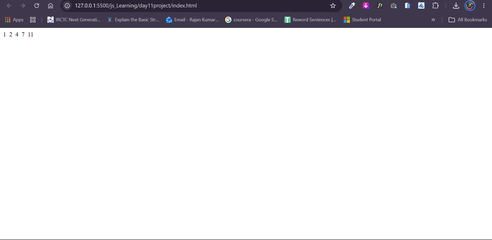

# JavaScript Number Pattern Program

## 📌 Description

This JavaScript program takes a number from the user and prints a number
pattern using a `for` loop.

The program starts with `a = 1` and adds the current value of `i` in
every iteration.

```
Number-Pattern/
│
├── README.md
├── index.html
├── js
│   ├── q1.js
│   ├── q2.js
│   ├── q3.js
│   ├── q4.js
│   ├── q5.js
│   ├── q6.js
│   ├── q7.js
└── screenshots/
    └── output.png
```

## 💻 Code

``` javascript
let num = +prompt(`Enter Any Number: `);

let a = 1;

for (let i = 1; i <= num; i++) {
    document.write(`${a} &nbsp;`);

    a = a + i;
}
```

## ⚙️ How It Works

1.  The user enters a number using `prompt()`.
2.  The variable `a` starts from `1`.
3.  The `for` loop runs from `1` to the entered number.
4.  `document.write()` prints the current value of `a`.
5.  `a = a + i` adds the current value of `i` to `a`.
6.  The loop continues until the condition becomes false.

## 📥 Example

**Input:**

``` text
Enter Any Number: 5
```

**Output:**

``` text
1  2  4  7  11
```

## 🧠 Logic

  Iteration     i   a (Before)   a (After)
  ----------- --- ------------ -----------
  1             1            1           2
  2             2            2           4
  3             3            4           7
  4             4            7          11
  5             5           11          16

The final value `16` is calculated but not printed because
`document.write()` runs before the addition.

## 🖼️ Screenshots

Add your program screenshots in a folder named `screenshots`.

### Output Screenshot




> Replace `output.png` with your actual screenshot file
> names, or keep these names for your images.

## 🛠️ Technologies Used

-   HTML
-   JavaScript

## 🚀 Concepts Covered

-   `prompt()`
-   Variables
-   `for` loop
-   Addition operator
-   `document.write()`

## 👨‍💻 Author

Rajan Kumar Tiwari

GitHub: [Heytiwari](https://github.com/Heytiwari)
