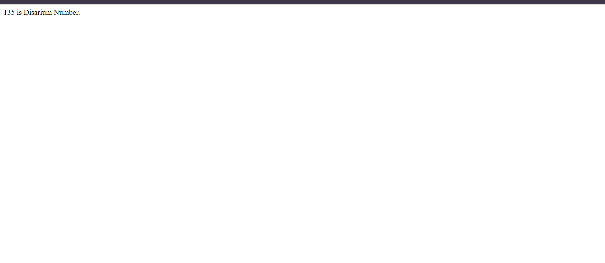

# JavaScript Disarium Number Checker

## 📌 Description

This JavaScript program checks whether a number is a **Disarium Number**
or not.

A Disarium number is a number in which the sum of its digits raised to
their respective positions is equal to the original number.

**Example:**

`135 = 1¹ + 3² + 5³ = 135`

Therefore, `135` is a Disarium Number.

```
day11project/
├── README.md
├── index.html
├── js
│   └── q2.js
└── screenshots/
    └── q2.png
```

## 💻 Code

``` javascript
let num = +prompt("Enter Any Number: ");

let orgNum = num;
let sum = 0;
let count = 0;

while (num !== 0) {
    let rem = num % 10;
    count++;
    let mul = 1;

    for(let i = 1; i <= count; i++){
        mul *= rem;
    }
    sum += mul;
    num = Math.floor(num / 10);
    count--;
}

(sum === orgNum)
    ? document.write(`${orgNum} is Disarium Number.`)
    : document.write(`${orgNum} is Not Disarium Number.`);
```

## ⚙️ How It Works

1.  `prompt()` asks the user to enter a number.
2.  `orgNum` stores the original number for comparison.
3.  The first `while` loop counts the number of digits.
4.  The second `while` loop extracts digits from right to left.
5.  Each digit is raised to its correct position using `rem ** count`.
6.  The powered digits are added to `sum`.
7.  The program compares `sum` with `orgNum` and prints the result.

## 📥 Example

**Input:**

``` text
Enter Any Number: 135
```

**Calculation:**

``` text
1¹ + 3² + 5³
1 + 9 + 125
= 135
```

**Output:**

``` text
135 is Disarium Number.
```

## 🧠 Another Example

**Input:**

``` text
Enter Any Number: 123
```

**Calculation:**

``` text
1¹ + 2² + 3³
1 + 4 + 27
= 32
```

**Output:**

``` text
123 is Not Disarium Number.
```

## 🖼️ Screenshots

Add your screenshots inside a folder named `screenshots`.

### Output Screenshot



Use these file names for your screenshots, or update the image paths
above to match your actual names.

## 🛠️ Technologies Used

-   HTML
-   JavaScript

## 🚀 Concepts Covered

-   `prompt()`
-   Variables
-   `while` loop
-   Digit extraction using `%`
-   Integer division using `Math.floor()`
-   Exponentiation using `**`
-   Conditional (ternary) operator
-   `document.write()`

## 👨‍💻 Author

Rajan Kumar Tiwari

GitHub: [Heytiwari](https://github.com/Heytiwari)
