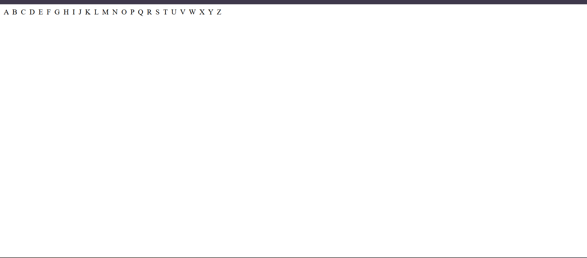

# JavaScript Print Characters Between Two Given Characters

## 📌 Description

This JavaScript program prints all characters from a starting character to an ending character (both inclusive) using a `do-while` loop.

The input characters should be uppercase or lowercase alphabets.

## 📂 Project Structure

```text
day11project/
├── question4.md
├── index.html
├── js/
│   └── q4.js
└── screenshots/
    └── q4.png
```

## 💻 Code

```javascript
let startCharacter = prompt(`Enter Start Character: `);
let endCharacter = prompt(`Enter End Character: `);

do {
    document.write(`${startCharacter} &nbsp;`);

    startCharacter = String.fromCharCode(startCharacter.charCodeAt(0) + 1);

} while (startCharacter <= endCharacter);
```

## ⚙️ How It Works

1. The user enters a starting character using `prompt()`.
2. The user enters an ending character using `prompt()`.
3. The `do-while` loop prints the current character.
4. `charCodeAt(0)` gets the Unicode value of the character.
5. `String.fromCharCode()` converts the next Unicode value into a character.
6. The character increases by one in every iteration.
7. The loop continues until the ending character is reached.

## 📥 Example

**Input:**

```text
Enter Start Character: D
Enter End Character: M
```

**Output:**

```text
Characters from D to M: D E F G H I J K L M
```

## 🖼️ Screenshots

### Output Screenshot



## 🎥 Project Video Preview

https://github.com/user-attachments/assets/7aa940a6-252e-44e7-bdff-1876a67dded0

## 🛠️ Technologies Used

- HTML
- JavaScript

## 🚀 Concepts Covered

- `prompt()`
- Variables
- `do-while` loop
- `charCodeAt()`
- `String.fromCharCode()`
- `document.write()`

## 👨‍💻 Author

Rajan Kumar Tiwari

GitHub: [Heytiwari](https://github.com/Heytiwari)
