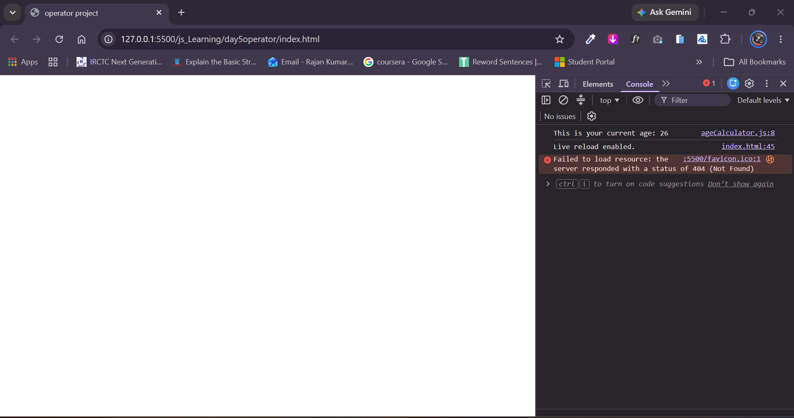

https://github.com/user-attachments/assets/ad1113fb-475c-41c2-ba04-56197ec0459a

# Age Calculator (JavaScript)

A simple console-based JavaScript application that calculates a user's current age based on their birth year and the target calendar year.

---

## 📌 Features

- **Interactive User Prompt:** Asks the user to provide their year of birth using the browser's `prompt()` function.
- **Unary Numeric Coercion:** Uses the unary `+` operator to convert the string input into an integer.
- **Accurate Difference Calculation:** Determines current age using the simple formula: $\text{Age} = \text{Current Year} - \text{Birth Year}$.
- **Developer Console Output:** Prints the resulting age directly to the browser console.

---

## 🧮 Calculation Formula

$$
\text{Age} = \text{Current Year} - \text{Birth Year}
$$

*Example:*
- **Current Year:** $2026$
- **Birth Year:** $2002$
- **Current Age:** $2026 - 2002 = 24$

---

## 💻 Source Code

```javascript
let birthOfYear = +prompt("Enter Birth Year: ");

let currentYear = 2026;

let currentAge = currentYear - birthOfYear;

console.log("This is your current age: " + currentAge);
```

---

## 🚀 How to Run the Project

### Option 1: Browser Console (Quickest)

1. Open any web browser (Google Chrome, Mozilla Firefox, Microsoft Edge, Safari).
2. Open the Developer Tools:
   - **Windows / Linux:** Press `F12` or `Ctrl + Shift + I`
   - **macOS:** Press `Cmd + Option + I`
3. Click on the **Console** tab.
4. Copy and paste the JavaScript code into the console, then hit **Enter**.
5. Enter your birth year (e.g., `2000`) in the browser prompt and click **OK**.
6. View your calculated age printed in the console.

### Option 2: Run via HTML File

1. Create an `index.html` file in your project folder.
2. Link your JavaScript file:

```html
<!DOCTYPE html>
<html lang="en">
<head>
  <meta charset="UTF-8" />
  <meta name="viewport" content="width=device-width, initial-scale=1.0" />
  <title>Age Calculator</title>
</head>
<body>
  <h1>Age Calculator</h1>
  <script src="script.js"></script>
</body>
</html>
```

3. Double-click or open `index.html` in your web browser.

---

## 📸 Screenshots

### Console Result
*Add a screenshot showing the calculated age printed in the browser developer console.*




## 📸 Video


https://github.com/user-attachments/assets/83048422-39b7-44ae-a820-cfcf57682ed2


---

## 📁 Suggested Directory Structure

```text
age-calculator/
├── index.html
├── script.js
├── README.md
└── screenshots/
    └── console-output.png
    
```
---

## 📝 License

This project is open-source and free to use for educational and practice purposes.
