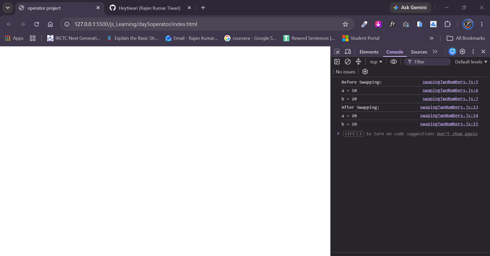

# Swap Two Numbers Without a Temporary Variable (Bitwise XOR)

A lightweight JavaScript program that swaps the values of two variables without using any third (temporary) variable or arithmetic operators, utilizing the bitwise XOR (`^`) operator.

---

## 📌 Features

- **No Extra Memory (In-Place Swap):** Swaps values directly without creating an auxiliary or temporary variable ($O(1)$ auxiliary space).
- **Fast Bitwise Operations:** Utilizes bit-level manipulation via the XOR (`^`) operator.
- **Dynamic Input:** Prompts the user for two numerical values using browser `prompt()`.
- **Clear Console Feedback:** Logs the state of both variables before and after swapping.

---

## 🧠 How the XOR Logic Works

The XOR operation has two key properties:
1. $x \oplus x = 0$ (Any number XORed with itself is 0)
2. $x \oplus 0 = x$ (Any number XORed with 0 is itself)
3. It is commutative and associative: $(a \oplus b) \oplus a = b$

### Step-by-Step Breakdown:

Given initial values $a$ and $b$:

1. **`a = a ^ b;`**  
   Now `a` stores the combined bit mask of both numbers ($a \oplus b$).
2. **`b = a ^ b;`**  
   Substituting `a`: $b = (a \oplus b) \oplus b = a \oplus (b \oplus b) = a \oplus 0 = a$.  
   *`b` now holds the original value of `a`.*
3. **`a = a ^ b;`**  
   Substituting: $a = (a \oplus b) \oplus a = b \oplus (a \oplus a) = b \oplus 0 = b$.  
   *`a` now holds the original value of `b`.*

Both values are successfully swapped!

---

## 💻 Source Code

```javascript
let a = +prompt("Enter First Number: ");  // e.g., 10
let b = +prompt("Enter Second Number: "); // e.g., 20

console.log("Before Swapping:");
console.log("a = " + a);
console.log("b = " + b);

// Swapping using XOR bitwise operator
a = a ^ b;
b = a ^ b;
a = a ^ b;

console.log("After Swapping:");
console.log("a = " + a);
console.log("b = " + b);
```

---

## 🚀 How to Run

### Method 1: Browser Developer Console
1. Open any web browser (Google Chrome, Firefox, Microsoft Edge, Brave, etc.).
2. Open Developer Tools:
   - **Windows / Linux:** Press `F12` or `Ctrl + Shift + I`
   - **macOS:** Press `Cmd + Option + I`
3. Go to the **Console** tab.
4. Paste the JavaScript code and press **Enter**.
5. Enter the first and second numbers in the prompt popups.
6. Check the swapped outputs logged in the console.

### Method 2: Via HTML File
1. Create an `index.html` file.
2. Link the script using `<script src="swap.js"></script>` or inside a `<script>` tag.
3. Open `index.html` in your browser.

---

## 📸 Screenshots

<<<<<<< HEAD
=======
## 📸 Screenshots

>>>>>>> cb2df5848de80e77e9d0fbff7d5181b0148b1782
### wapped Output in Console
*Add a screenshot showing the prompt asking for input values.*


<<<<<<< HEAD
=======

## 📸 video


https://github.com/user-attachments/assets/0df94475-0f53-4463-9bf3-1e70f7623874


---

### 2. Swapped Output in Console
*Add a screenshot showing the console displaying values before and after swapping.*


>>>>>>> cb2df5848de80e77e9d0fbff7d5181b0148b1782

---

## 📁 Suggested Directory Structure

```text
bitwise-swap/
├── index.html
├── script.js
├── README.md
└── screenshots/
    ├── prompt-input.png
    └── console-output.png
```

---

## 📄 License

This project is open-source and free to use for educational and learning purposes.
