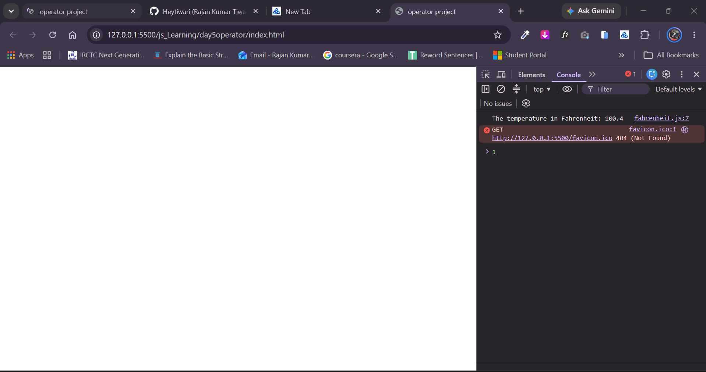

# Celsius to Fahrenheit Temperature Converter (JavaScript)

A lightweight console-based JavaScript application that takes a temperature reading in Celsius from user input and converts it into Fahrenheit using the standard temperature conversion formula.

---

## 📌 Features

- **Interactive User Prompt:** Prompts the user to enter a temperature value in Celsius via the browser `prompt()` dialog.
- **Type Conversion:** Uses `Number()` to reliably parse the input string into a floating-point or integer value.
- **Accurate Mathematical Conversion:** Uses the standard formula: $(^\circ\text{C} \times \frac{9}{5}) + 32$.
- **Console Output:** Outputs the converted Fahrenheit value clearly to the developer console.

---

## 🧮 Conversion Formula

$$F = \left(C \times \frac{9}{5}\right) + 32$$

*Where:*
- **$C$** = Temperature in Celsius ($^\circ\text{C}$)
- **$F$** = Temperature in Fahrenheit ($^\circ\text{F}$)

---

## 💻 Source Code

```javascript
let celcius = Number(prompt("The temperature in Celsius: "));

let fahrenheit = (celcius * 9 / 5) + 32;

console.log("The temperature in Fahrenheit: " + fahrenheit);
```

---

## 🚀 How to Run the Project

### Option 1: Browser Console (Quickest)
1. Open any modern web browser (Google Chrome, Mozilla Firefox, Microsoft Edge, Safari).
2. Open Developer Tools:
   - **Windows / Linux:** Press `F12` or `Ctrl + Shift + I`
   - **macOS:** Press `Cmd + Option + I`
3. Navigate to the **Console** tab.
4. Paste the code into the console and press **Enter**.
5. Enter a Celsius value (e.g., `25`, `0`, `100`) in the popup dialog and click **OK**.
6. View the converted Fahrenheit temperature printed in the console.

### Option 2: Run via HTML File
1. Create an `index.html` file in your project folder.
2. Link your JavaScript file:
   ```html
   <!DOCTYPE html>
   <html lang="en">
   <head>
     <meta charset="UTF-8" />
     <meta name="viewport" content="width=device-width, initial-scale=1.0" />
     <title>Celsius to Fahrenheit Converter</title>
   </head>
   <body>
     <h1>Celsius to Fahrenheit Converter</h1>
     <script src="script.js"></script>
   </body>
   </html>
   ```
3. Open `index.html` in your web browser.

---

## 📸 Screenshots

### Console Result
*Add a screenshot showing the calculated Fahrenheit result printed in the console.*



## 📸 video


https://github.com/user-attachments/assets/ba6da095-a156-4afa-8613-f4edfd9d0d58


---

## 📁 Suggested Directory Structure

```text
temperature-converter/
├── index.html
├── script.js
├── README.md
└── screenshots/
    └── console-output.png
```

---

## 📝 License

This project is open-source and free to use for practice and educational purposes.
