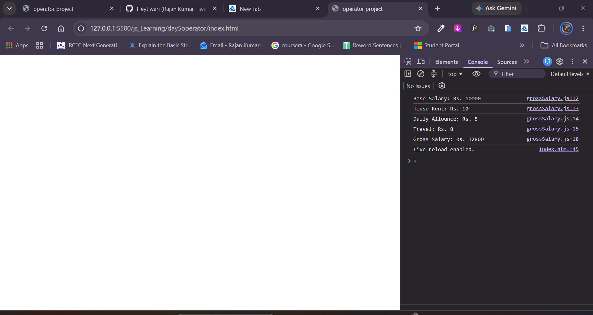

# Gross Salary Calculator (JavaScript)

A lightweight console-based JavaScript application designed to compute the **Gross Salary** of an employee by accepting the base salary and allowance percentages (HRA, DA, and TA) from user prompts.

---

## 📌 Features

- **Interactive User Input:** Collects base salary and percentage allowances directly using browser `prompt()` dialogs.
- **Type Casting:** Converts raw string prompt values directly into numerical values using the unary plus (`+`) operator.
- **Allowance Calculations:** Calculates allowances as percentage additions based on the Base Salary:
  - **HRA** (House Rent Allowance)
  - **DA** (Dearness Allowance)
  - **TA** (Travel Allowance)
- **Detailed Console Breakdown:** Logs both the individual allowance inputs and the calculated total Gross Salary.

---

## 🧮 Salary Calculation Formula

The Gross Salary is calculated using the following mathematical relationship:

$$\text{Gross Salary} = \text{Base Salary} + \left( \text{Base Salary} \times \frac{\text{HRA}}{100} \right) + \left( \text{Base Salary} \times \frac{\text{DA}}{100} \right) + \left( \text{Base Salary} \times \frac{\text{TA}}{100} \right)$$

---

## 💻 Source Code

```javascript
let baseSalary = +prompt("Enter Base Salary: ");
let hra = +prompt("Enter HRA (%): ");
let da = +prompt("Enter DA (%): ");
let ta = +prompt("Enter TA (%): ");

// Calculating gross salary with allowance percentages
let grossSalary = baseSalary + (baseSalary * hra / 100) + (baseSalary * da / 100) + (baseSalary * ta / 100);

console.log("Base Salary: Rs. " + baseSalary);
console.log("House Rent Allowance (HRA): " + hra + "%");
console.log("Dearness Allowance (DA): " + da + "%");
console.log("Travel Allowance (TA): " + ta + "%");
console.log("-----------------------------------");
console.log("Gross Salary: Rs. " + grossSalary);
```

> **Note:** In the formula calculation, make sure `da` is used for Dearness Allowance rather than repeating `hra`.

---

## 🚀 How to Run

### Method 1: Using the Browser Console

1. Open any modern web browser (Google Chrome, Firefox, Microsoft Edge, Safari).
2. Open the Developer Tools:
   - **Windows / Linux:** Press `F12` or `Ctrl + Shift + I`
   - **macOS:** Press `Cmd + Option + I`
3. Select the **Console** tab.
4. Copy and paste the JavaScript code into the console, then hit **Enter**.
5. Input the values sequentially when prompted:
   - Base Salary (e.g., `25000`)
   - HRA percentage (e.g., `10`)
   - DA percentage (e.g., `5`)
   - TA percentage (e.g., `8`)
6. Review the itemized results logged in the console.

### Method 2: Via HTML File

1. Create an `index.html` file in your project folder.
2. Link your script inside `<script src="script.js"></script>` or place it inside a `<script>` tag before `</body>`.
3. Open `index.html` in your web browser.

---

## 📸 Screenshots
### Salary Breakdown & Console Output
*Add a screenshot of the browser console displaying the itemized salary and final Gross Salary.*



---

## 📁 Suggested Directory Structure

```text
gross-salary-calculator/
├── index.html
├── script.js
├── README.md
└── screenshots/
    └── console-output.png
```

---

## 📄 License

This project is open-source and free to use for educational and learning purposes.