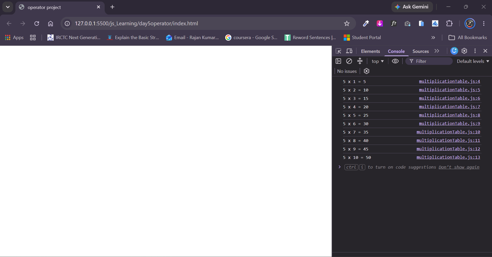

# Multiplication Table Generator (JavaScript)

A lightweight console-based JavaScript application that accepts an integer input from the user and prints its complete mathematical multiplication table (from 1 to 10) directly to the browser console.

---

## 📌 Features

- **Interactive User Input:** Utilizes the browser's `prompt()` function to collect the desired table base number.
- **Explicit Type Conversion:** Uses the unary plus operator (`+`) to convert string input from the prompt directly to a numeric value.
- **Sequential Math Calculations:** Multiplies the input number across multipliers 1 through 10.
- **Clean Console Output:** Displays results in standard mathematical multiplication table formatting (`N x i = Result`).

---

## 💻 Source Code

```javascript
let tableNumber = +prompt("Enter Table Number: ");

console.log(tableNumber + " x 1 = " + (tableNumber * 1));
console.log(tableNumber + " x 2 = " + (tableNumber * 2));
console.log(tableNumber + " x 3 = " + (tableNumber * 3));
console.log(tableNumber + " x 4 = " + (tableNumber * 4));
console.log(tableNumber + " x 5 = " + (tableNumber * 5));
console.log(tableNumber + " x 6 = " + (tableNumber * 6));
console.log(tableNumber + " x 7 = " + (tableNumber * 7));
console.log(tableNumber + " x 8 = " + (tableNumber * 8));
console.log(tableNumber + " x 9 = " + (tableNumber * 9));
console.log(tableNumber + " x 10 = " + (tableNumber * 10));
```

---

## 🚀 How to Run

### Method 1: Using the Browser Console

1. Open any web browser (Google Chrome, Firefox, Microsoft Edge, Brave, Safari).
2. Open the Developer Tools:
   - **Windows / Linux:** Press `F12` or `Ctrl + Shift + I`
   - **macOS:** Press `Cmd + Option + I`
3. Click on the **Console** tab.
4. Copy and paste the JavaScript code into the console, then press **Enter**.
5. Enter the number you want the multiplication table for in the prompt dialog.
6. Check the complete table output logged directly in the console.

### Method 2: Via HTML File

1. Create an `index.html` file in your project folder.
2. Link the script using `<script src="script.js"></script>` or place it inside a `<script>` tag before `</body>`.
3. Open `index.html` in your web browser.

---

## 📸 Screenshots

###  Table Output in Console
*Add a screenshot showing the printed multiplication table results inside the developer console.*



## 📸 video


https://github.com/user-attachments/assets/0b7cd2ac-f5dc-4c02-8665-5ac71c8980b5


## 📁 Suggested Directory Structure

```text
multiplication-table/
├── index.html
├── script.js
├── README.md
└── screenshots/
    └── console-output.png
```

---

## 📄 License

This project is open-source and free to use for practice and educational purposes.
