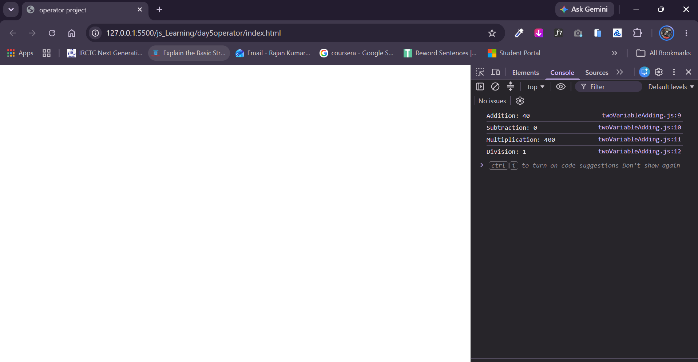

# Simple Calculator (JavaScript)

A lightweight and simple console-based arithmetic calculator written in pure JavaScript. It takes two numeric inputs from the user via browser dialog prompts and computes four basic arithmetic operations: Addition, Subtraction, Multiplication, and Division.

---

## 📌 Features

- **Interactive Prompts**: Prompts the user to enter numbers interactively using `prompt()`.
- **Automatic Numeric Conversion**: Uses the unary plus operator (`+`) to convert string input into standard JavaScript numbers.
- **Fundamental Arithmetic Operations**:
  - **Addition** (`+`)
  - **Subtraction** (`-`)
  - **Multiplication** (`*`)
  - **Division** (`/`)
- **Console Output**: Cleanly formats and outputs the results to the browser developer console.

---

## 💻 Source Code

```javascript
let a = +prompt("Enter First Number: ");
let b = +prompt("Enter Second Number: ");

let addition = a + b;
let subtraction = a - b;
let multiplication = a * b;
let division = a / b;

console.log("Addition: " + addition);
console.log("Subtraction: " + subtraction);
console.log("Multiplication: " + multiplication);
console.log("Division: " + division);
```

---

## 🚀 How to Run

### Method 1: Directly in Browser Console

1. Open any web browser (Google Chrome, Firefox, Edge, Brave, etc.).
2. Open developer tools:
   - **Windows / Linux**: Press `F12` or `Ctrl + Shift + I`
   - **macOS**: Press `Cmd + Option + I`
3. Navigate to the **Console** tab.
4. Paste the source code into the console and press **Enter**.
5. Enter the first and second numbers in the pop-up dialog boxes.
6. Check the console for the results.

### Method 2: In an HTML Project

1. Create a file named `index.html`.
2. Link the script using `<script src="script.js"></script>` or place the code inside a `<script>` tag.
3. Open `index.html` in your browser.

---

## 📸 Screenshots

### Output in Developer Console
View the computed arithmetic operations printed in the console:



## 📸 video


https://github.com/user-attachments/assets/de92f996-db81-4908-867a-980ed4d9764e


---

## 📁 Suggested Directory Structure

```text
simple-calculator/
├── index.html
├── script.js
├── README.md
└── screenshots/
    ├── prompt-input.png
    └── console-output.png
```

---

## 📄 License

This project is open-source and free to use for practice and educational purposes.
