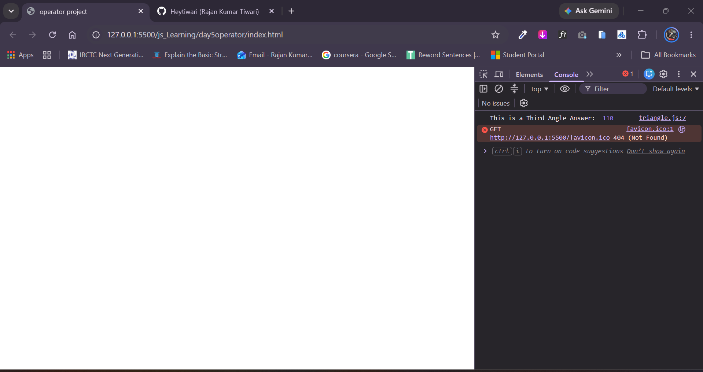

# Triangle Third Angle Finder (JavaScript)

A lightweight console-based JavaScript utility that calculates the unknown third interior angle of a triangle given two angles, using the Angle Sum Property of a triangle ($180^\circ$).

---

## 📌 Features

- **Interactive Prompts**: Prompts the user to enter the first two angles using browser `prompt()`.
- **Automatic Type Conversion**: Uses the unary plus operator (`+`) to parse string inputs into numbers.
- **Mathematical Formula**: Implements the fundamental geometric rule:
  $$\text{thirdAngle} = 180 - (\text{firstAngle} + \text{secondAngle})$$
- **Console Output**: Clearly logs the calculated third angle in the browser console.

---

## 💻 Source Code

```javascript
let firstAngle = +prompt("First angle: ");
let secondAngle = +prompt("Second angle: ");

let thirdAngle = 180 - (firstAngle + secondAngle);

console.log("This is a Third Angle Answer: ", thirdAngle);
```

---

## 🚀 How to Run

### Method 1: Browser Developer Console
1. Open any web browser (Chrome, Edge, Firefox, Brave, etc.).
2. Open the Developer Tools:
   - **Windows / Linux**: Press `F12` or `Ctrl + Shift + I`
   - **macOS**: Press `Cmd + Option + I`
3. Click on the **Console** tab.
4. Copy and paste the JavaScript code into the console and hit **Enter**.
5. Input the two known angles in the alert dialogs and check the computed third angle in the console.

### Method 2: In an HTML Document
1. Create a file called `index.html`.
2. Insert `<script src="script.js"></script>` or place the script directly inside a `<script>` tag.
3. Open `index.html` in your browser.

---

## 📸 Screenshots

### Calculated Result in Console
*Output showing the calculated third angle:*




## 📁 Suggested Directory Structure

```text
triangle-angle-finder/
├── index.html
├── script.js
├── README.md
└── screenshots/
    └── console-output.png
```

---

## 📄 License

This project is open-source and free to use for educational and learning purposes.