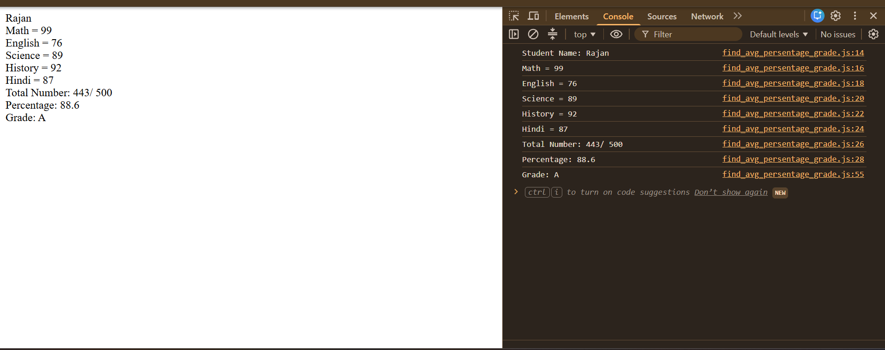

# Student Grade Calculator

## 📌 Project Description

The Student Grade Calculator is a beginner-friendly JavaScript project that takes a student's name, five subject names, and their marks as input. It calculates the total marks, percentage, and final grade, then displays the results in the browser and console.

## 🚀 Features

- Takes the student's name as input.
- Accepts five subject names and their marks.
- Calculates total marks out of 500.
- Calculates the percentage.
- Assigns a grade based on the percentage.
- Displays results using `console.log()` and `document.write()`.

## 💻 Source Code

```javascript

let studentName = prompt(`Enter Student Name: `);

let subjectName1 = prompt(`Enter Subject Name: `);
let subjectNum1 = +prompt(`Enter Subject Number: `);

let subjectName2 = prompt(`Enter Subject Name: `);
let subjectNum2 = +prompt(`Enter Subject Number: `);

let subjectName3 = prompt(`Enter Subject Name: `);
let subjectNum3 = +prompt(`Enter Subject Number: `);

let subjectName4 = prompt(`Enter Subject Name: `);
let subjectNum4 = +prompt(`Enter Subject Number: `);

let subjectName5 = prompt(`Enter Subject Name: `);
let subjectNum5 = +prompt(`Enter Subject Number: `);

let totalNumber = subjectNum1 + subjectNum2 + subjectNum3 + subjectNum4 + subjectNum5;

let percentage = (totalNumber / 500) * 100;

console.log(`Student Name: ${studentName}`);

console.log(`${subjectName1} = ${subjectNum1}`);

console.log(`${subjectName2} = ${subjectNum2}`);

console.log(`${subjectName3} = ${subjectNum3}`);

console.log(`${subjectName4} = ${subjectNum4}`);

console.log(`${subjectName5} = ${subjectNum5}`);

console.log(`Total Number: ${totalNumber}/ 500`);

console.log(`Percentage: ${percentage}`);


document.write(`${studentName}<br>`);

document.write(`${subjectName1} = ${subjectNum1}<br>`);

document.write(`${subjectName2} = ${subjectNum2}<br>`);

document.write(`${subjectName3} = ${subjectNum3}<br>`);

document.write(`${subjectName4} = ${subjectNum4}<br>`);

document.write(`${subjectName5} = ${subjectNum5}<br>`);

document.write(`Total Number: ${totalNumber}/ 500 <br>`);

document.write(`Percentage: ${percentage}<br>`);


if((percentage > 90) && (percentage <= 100)){
    console.log(`Grade: A+`);
    document.write(`Grade: A+`);
}
else if((percentage > 80) && (percentage <= 90)){
    console.log(`Grade: A`);
    document.write(`Grade: A`);
}
else if((percentage > 70) && (percentage <= 80)){
    console.log(`Grade: B+`);
    document.write(`Grade: B+`);
}
else if((percentage > 60) && (percentage <= 70)){
    console.log(`Grade: B`);
    document.write(`Grade: B`);
}
else if((percentage > 50) && (percentage <= 60)){
    console.log(`Grade: C+`);
    document.write(`Grade: C+`);
}
else if((percentage > 40) && (percentage <= 50)){
    console.log(`Grade: C`);
    document.write(`Grade: C`);
}
else if((percentage >= 33) && (percentage <= 40)){
    console.log(`Grade: D`);
    document.write(`Grade: D`);
}
else{
    console.log(`Grade: Fail`);
    document.write(`Grade: Fail`);
}
```

## 📊 Grading System

| Percentage | Grade |
|---|---|
| Above 90% to 100% | A+ |
| Above 80% to 90% | A |
| Above 70% to 80% | B+ |
| Above 60% to 70% | B |
| Above 50% to 60% | C+ |
| Above 40% to 50% | C |
| 33% to 40% | D |
| Below 33% | Fail |

## 📷 Sample Output

**Input Example:**

- Student Name: Rahul
- English: 95
- Mathematics: 90
- Science: 85
- Computer: 92
- Hindi: 88

**Expected Result:**

```text
Student Name: Rahul

Total Number: 450/500
Percentage: 90%
Grade: A
```

## 📸 Screenshots


## 📸 Project Video


## 🛠️ Technologies Used

- HTML5
- JavaScript

## 🎯 Learning Objectives

- Understanding variables and user input.
- Using arithmetic operators.
- Calculating total marks and percentages.
- Applying conditional statements (`if`, `else if`, and `else`).
- Displaying output using `console.log()` and `document.write()`.

## 👨‍💻 Author

**Rajan Kumar Tiwari**

GitHub: [Heytiwari](https://github.com/Heytiwari)
