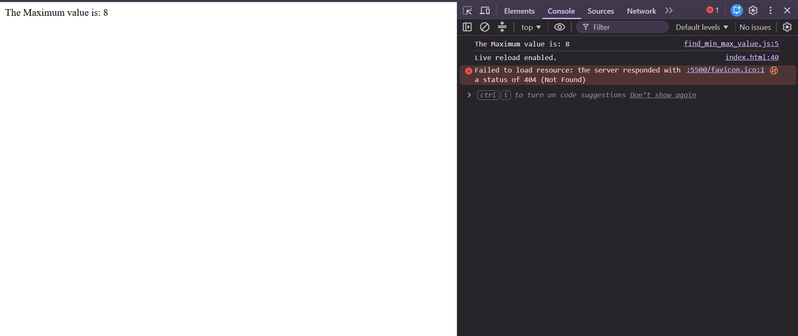

# Maximum and Minimum Number Calculator

## 📌 Project Description

This is a simple JavaScript program that takes two numbers as input from the user and compares them using an `if-else` statement. It displays the maximum or minimum value in the console and on the webpage.

## 🚀 Features

- Takes two numbers as input using `prompt()`.
- Compares both numbers using `if-else`.
- Displays the result using `console.log()`.
- Displays the result on the webpage using `document.write()`.

## 💻 Source Code

```javascript
let a = +prompt("Enter a value of the first number: ");
let b = +prompt("Enter a value of the second number: ");

if (a > b) {
    console.log(`The Maximum value is: ${a}`);
    document.write(`The Maximum value is: ${a}`);
} else {
    console.log(`The Minimum value is: ${a}`);
    document.write(`The Minimum value is: ${a}`);
}
```

## 📷 Output

### Example 1

**Input:**
```text
Enter a value of the first number: 20
Enter a value of the second number: 10
```

**Output:**
```text
The Maximum value is: 20
```

### Example 2

**Input:**
```text
Enter a value of the first number: 5
Enter a value of the second number: 15
```

**Output:**
```text
The Minimum value is: 5
```

## 📸 Screenshots


## 📸 Project video

https://github.com/user-attachments/assets/9a3af7ae-6e21-4e2a-b3d8-1d3cb3e048d9

## 🛠️ Technologies Used

- HTML5
- JavaScript

## 🎯 Learning Objectives

- Understanding JavaScript variables.
- Taking user input with `prompt()`.
- Using comparison operators.
- Understanding `if-else` statements.
- Displaying output with `console.log()` and `document.write()`.

## 👨‍💻 Author

**Rajan Kumar Tiwari**

GitHub: [Heytiwari](https://github.com/Heytiwari)
