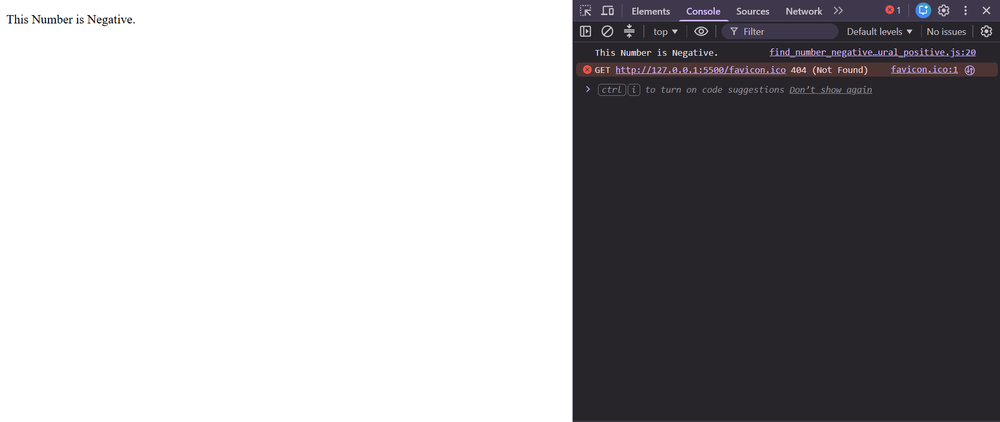

# Positive, Negative and Zero Number Checker

## 📌 Project Description

This is a simple JavaScript program that takes a number as input from the user and checks whether the number is positive, negative, or zero. The result is displayed in the browser console and on the webpage.

## 🚀 Features

- Takes user input using `prompt()`.
- Checks whether a number is positive or negative.
- Identifies zero separately.
- Uses `if-else` conditional statements.
- Displays output using `console.log()` and `document.write()`.

## 💻 Source Code

```javascript
let num = +prompt("Enter Any Number: ");

if (num < 0) {
    console.log(`This Number is Negative.`);
    document.write(`<p>This Number is Negative.</p>`);
}
else if (num > 0) {
    console.log(`This Number is Positive.`);
    document.write(`<p>This Number is Positive.</p>`);
}
else {
    console.log(`This Number is Natural.`);
    document.write(`<p>This Number is Natural.</p>`);
}
```

## 📷 Output Examples

### Example 1: Positive Number

**Input:**
```text
Enter Any Number: 10
```

**Output:**
```text
This Number is Positive.
```

### Example 2: Negative Number

**Input:**
```text
Enter Any Number: -5
```

**Output:**
```text
This Number is Negative.
```

### Example 3: Zero

**Input:**
```text
Enter Any Number: 0
```

**Output:**
```text
This Number is Natural.
```

## 📸 Screenshots



## 📸 Project video
https://github.com/user-attachments/assets/888c538c-4b51-45d6-861a-243050c1c673
## 🛠️ Technologies Used

- HTML5
- JavaScript

## 🎯 Learning Objectives

- Understanding variables and user input.
- Using comparison operators (`<` and `>`).
- Practicing `if-else if-else` statements.
- Displaying results with `console.log()`.
- Showing output on a webpage with `document.write()`.

## 👨‍💻 Author

**Rajan Kumar Tiwari**

GitHub: [Heytiwari](https://github.com/Heytiwari)
